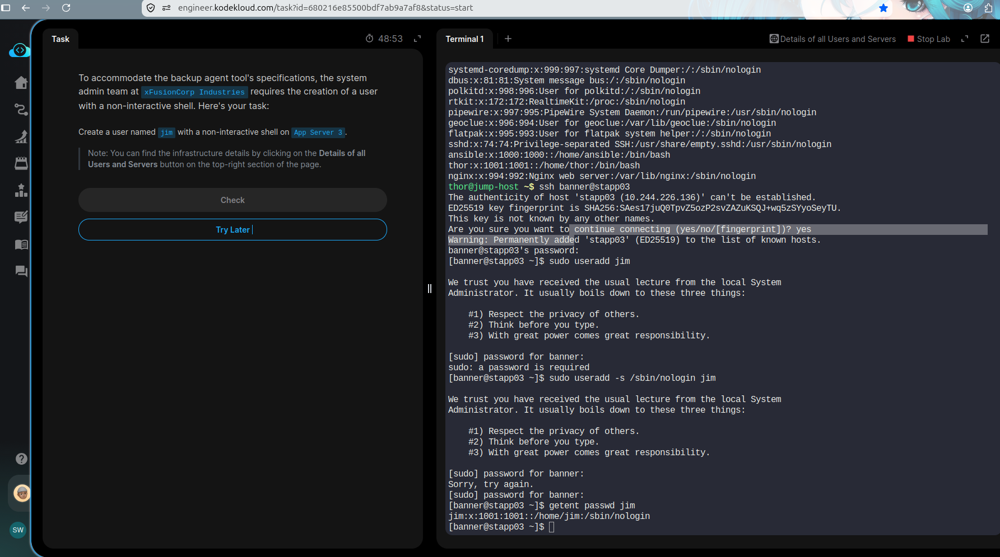

# Day 01: Linux User Management

## Objective
Create a Linux user named `jim` with a non-interactive shell.

## Concepts Learned
- Linux user management
- The `useradd` command
- Non-interactive shells
- User verification

## Command Used

```bash
sudo useradd -s /sbin/nologin jim
```

## Verification

```bash
getent passwd jim
```

Expected shell:

```text
/sbin/nologin
```

## Key Learning
The `useradd` command creates a user account. The `-s` option specifies the login shell, and `/sbin/nologin` prevents normal interactive login.

## Status
Completed

## Screenshot Evidence

### Linux User Creation

The following screenshot verifies that user `jim` has a non-interactive shell on App Server 3.




