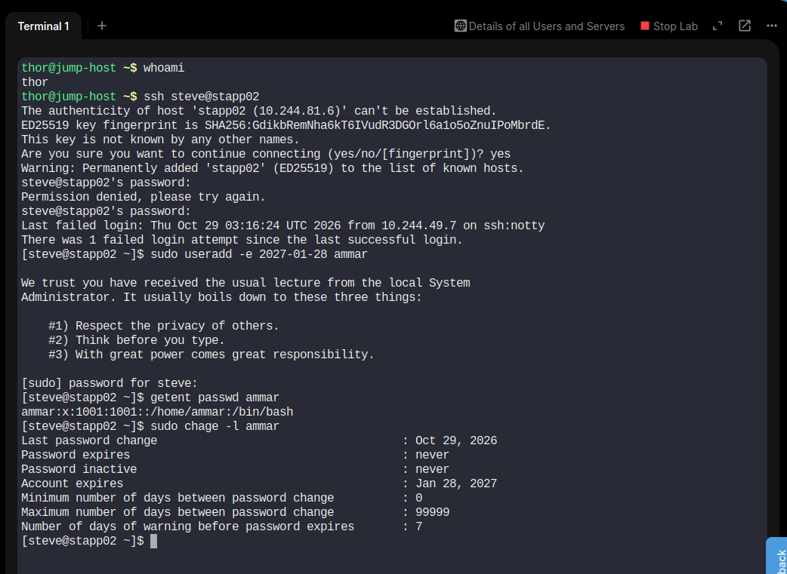
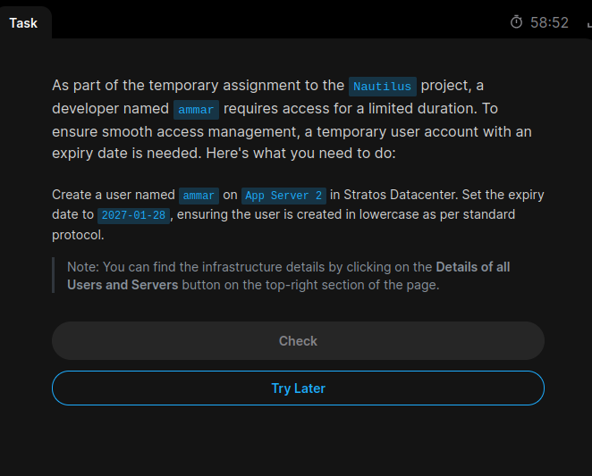

# Day 02: Linux User Account Expiry

## Task
Create a Linux user named `ammar` on App Server 2 (`stapp02`) with an account expiry date of `2027-01-28`.

## Commands Used

### 1. Connect to App Server 2
```bash
ssh steve@stapp02
```

### 2. Create the user with an expiry date
```bash
sudo useradd -e 2027-01-28 ammar
```

### 3. Verify the user
```bash
getent passwd ammar
```

### 4. Verify the expiry date
```bash
sudo chage -l ammar
```

## Concepts Learned
- `useradd`: Creates a Linux user account.
- `-e`: Sets the account expiry date.
- `getent passwd`: Retrieves user account information.
- `chage -l`: Displays account expiry and password aging information.


## Screenshot Evidence

### Task Question


### Task Solution


## Status
Completed the Linux user creation task and configured the account expiry date.

