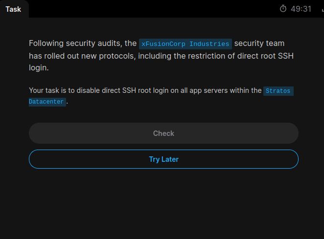
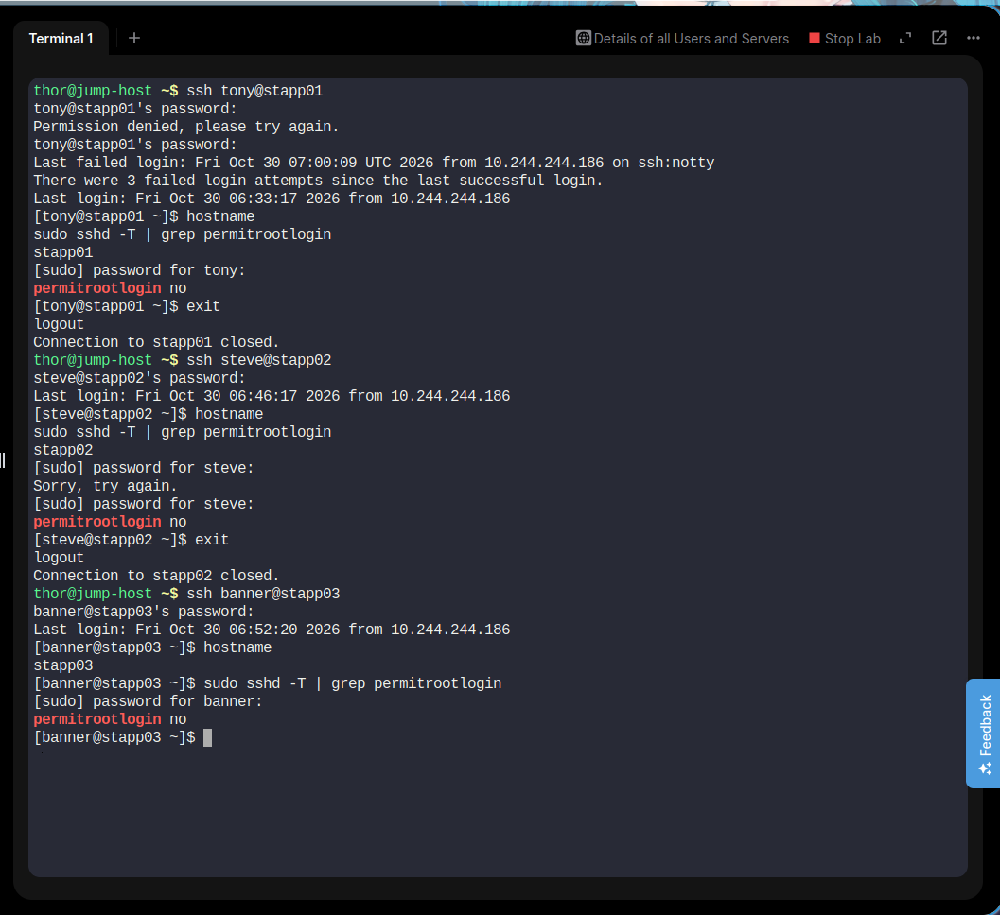

# Day 03 - Disable Root SSH Login on App Servers

## Task Description

The xFusionCorp Industries security team required direct root SSH login to be disabled on all application servers in the Stratos Datacenter as part of security hardening.

## Servers Configured

| Server | SSH User | Configuration |
|---|---|---|
| stapp01 | tony | `PermitRootLogin no` |
| stapp02 | steve | `PermitRootLogin no` |
| stapp03 | banner | `PermitRootLogin no` |

## Steps Performed

1. Connected to all three application servers through the Jump Host using SSH.
2. Checked the SSH configuration file: `/etc/ssh/sshd_config`.
3. Updated the active directive to `PermitRootLogin no`.
4. Validated the SSH configuration using `sudo sshd -t`.
5. Restarted the SSH service using `sudo systemctl restart sshd`.
6. Verified the effective configuration using `sudo sshd -T | grep permitrootlogin`.

## Verification

Expected output on all three servers:

```bash
permitrootlogin no
```

## Screenshot Evidence

### Task Question


### Task Solution


## Status

Completed successfully. Direct root SSH login has been disabled on all three application servers.
