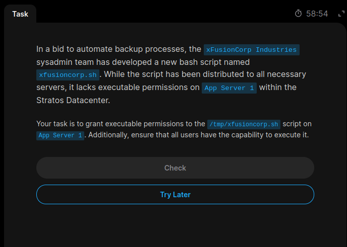
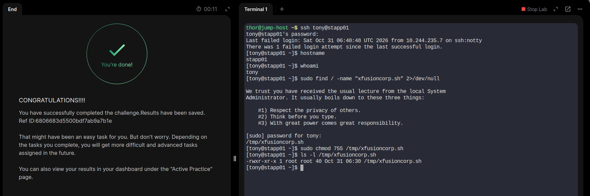

# Day 04 – Grant Executable Permissions to a Script

## Task Description

The xFusionCorp Industries sysadmin team developed a Bash script named `xfusioncorp.sh` to automate backup processes.

The script was distributed to the required servers but did not have executable permissions on App Server 2.

**Objective:** Grant executable permissions to `/tmp/xfusioncorp.sh` on App Server 2 and ensure all users can execute it.

## Server Details

- Server: App Server 2
- Hostname: `stapp02`
- User: `steve`
- Script Location: `/tmp/xfusioncorp.sh`

## Commands Used

### 1. Connect to App Server 2

```bash
ssh steve@stapp02
```

### 2. Check Existing Permissions

```bash
ls -l /tmp/xfusioncorp.sh
```

### 3. Grant Executable Permissions

```bash
sudo chmod 755 /tmp/xfusioncorp.sh
```

### 4. Verify Permissions

```bash
ls -l /tmp/xfusioncorp.sh
```

## Linux Permissions Explained

The `chmod 755` command sets the following permissions:

| User Category | Permission | Numeric Value |
|---|---|---|
| Owner | Read, Write, Execute | 7 |
| Group | Read, Execute | 5 |
| Others | Read, Execute | 5 |

Expected permission output:

```text
-rwxr-xr-x
```

This ensures that all users can execute the script.

## Screenshot Evidence

### Task Question


### Task Solution


## Key Learnings

- Understood Linux file permissions.
- Learned how to use the `chmod` command.
- Understood symbolic and numeric permission methods.
- Learned how to grant executable permissions to all users.
- Practiced remote server administration using SSH.

## Status

**Completed:** Configuring executable permissions for the backup script on App Server 2.

