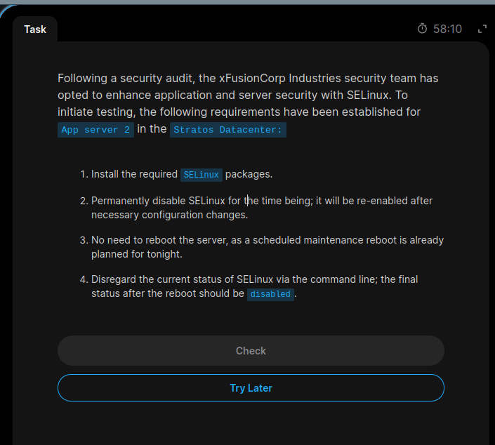
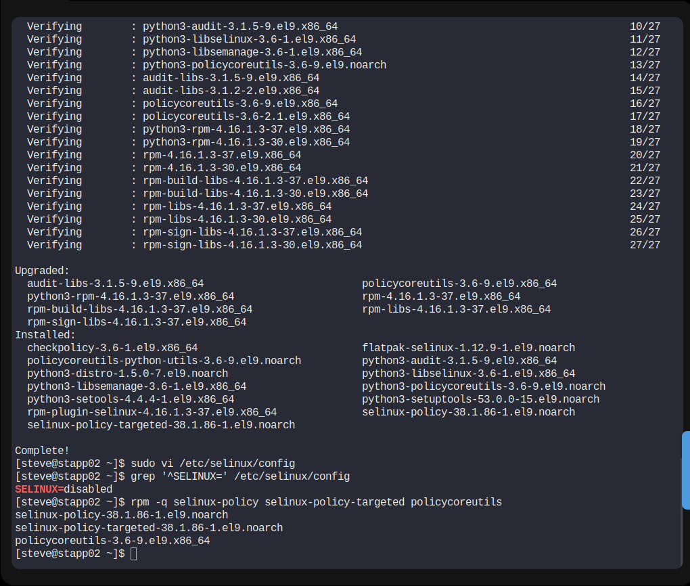

# Day 05: SELinux Installation and Configuration

## 📌 Task Overview

As part of the 100 Days of DevOps Challenge on KodeKloud Engineer, this task focuses on installing and configuring SELinux on App Server 2 in the Stratos Datacenter.

## 🎯 Requirements

1. Install the required SELinux packages.
2. Permanently disable SELinux.
3. Do not reboot the server.

## 🖥️ Server Information

| Detail | Value |
|---|---|
| Server | App Server 2 |
| Hostname | stapp02 |
| Username | steve |
| Operating System | CentOS Stream 9 |

## 🛠️ Implementation Steps

### 1. Connect to App Server 2

```bash
ssh steve@stapp02
```

### 2. Install SELinux Packages

```bash
sudo dnf install -y selinux-policy selinux-policy-targeted policycoreutils
```

### 3. Configure SELinux

Open the SELinux configuration file:

```bash
sudo vi /etc/selinux/config
```

Set the following parameter:

```ini
SELINUX=disabled
```

### 4. Verify SELinux Configuration

```bash
grep '^SELINUX=' /etc/selinux/config
```

Expected output:

```text
SELINUX=disabled
```

### 5. Verify Installed Packages

```bash
rpm -q selinux-policy selinux-policy-targeted policycoreutils
```

## 📸 Screenshot Evidence

### Task Question


### Task Solution


## 📚 Key Learnings

- Understanding SELinux and its role in Linux security.
- Installing SELinux packages using DNF.
- Understanding SELinux configuration modes.
- Modifying persistent system configuration.
- Verifying installed packages and configuration files.
- Understanding the difference between runtime and persistent configuration.

## ✅ Task Status

**Successfully Completed!**

SELinux packages were installed and SELinux was configured to be permanently disabled without rebooting the server.

---

**Challenge:** 100 Days of DevOps  
**Platform:** KodeKloud Engineer  
**Day:** 05

