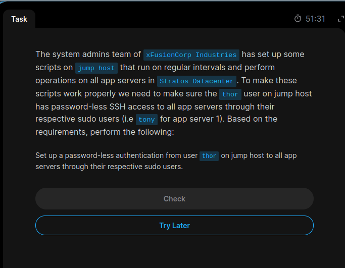
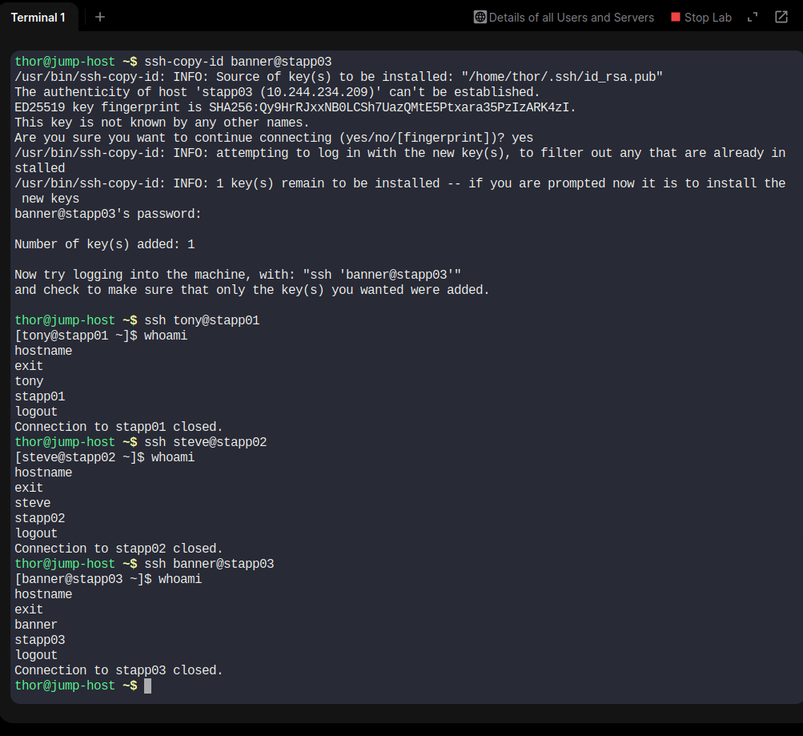

# Day 07 – Configure Passwordless SSH Authentication

## 📌 Task Overview

As part of the **100 Days of DevOps Challenge** on KodeKloud Engineer, I completed a Linux system administration task involving SSH key-based authentication.

The objective was to configure passwordless SSH access from the `thor` user on the Jump Host to all application servers in the Stratos Datacenter using their respective sudo users.

## 🎯 Requirements

Configure passwordless SSH authentication from:

- Jump Host user: `thor`

To the following application servers:

| Server | Username |
|---|---|
| App Server 1 (`stapp01`) | `tony` |
| App Server 2 (`stapp02`) | `steve` |
| App Server 3 (`stapp03`) | `banner` |

## 🛠️ Implementation

### Step 1: Verify Jump Host

```bash
whoami
hostname
```

Output:

```text
thor
jump-host
```

### Step 2: Generate SSH Key Pair

Generated an RSA SSH key pair on the Jump Host:

```bash
ssh-keygen -t rsa -b 4096
```

Accepted the default file location and left the passphrase empty to support non-interactive SSH authentication.

Generated files:

- `~/.ssh/id_rsa` – Private key
- `~/.ssh/id_rsa.pub` – Public key

Verify the generated keys:

```bash
ls -l ~/.ssh/
```

### Step 3: Copy Public Key to App Servers

Used `ssh-copy-id` to install the public key on each application server.

**App Server 1:**

```bash
ssh-copy-id tony@stapp01
```

**App Server 2:**

```bash
ssh-copy-id steve@stapp02
```

**App Server 3:**

```bash
ssh-copy-id banner@stapp03
```

Successful output:

```text
Number of key(s) added: 1
```

The public key was successfully installed on all three application servers.

### Step 4: Verify Passwordless SSH Access

Test SSH connections from the Jump Host:

```bash
ssh tony@stapp01
ssh steve@stapp02
ssh banner@stapp03
```

Verify the logged-in user and hostname on each server:

```bash
whoami
hostname
```

Each connection should work without asking for the remote user's password.

## 🔐 Security Best Practices

- Never share or upload private SSH keys to GitHub.
- Keep private keys protected with appropriate file permissions.
- Install public keys only on authorized servers.
- Use a passphrase for private keys in production environments where appropriate.
- Passwordless SSH authentication does not mean passwordless sudo access.

## 📚 Key Learnings

Through this task, I learned:

1. What SSH key-based authentication is.
2. The difference between public and private SSH keys.
3. How to generate RSA SSH key pairs.
4. How to use `ssh-copy-id` to distribute public keys.
5. How to configure passwordless SSH between multiple Linux servers.
6. How SSH authentication helps automate remote server administration.

## 📸 Screenshot Evidence

### Task Question



### Task Solution



## 🧰 Technologies & Commands

- Linux
- SSH
- RSA Key Authentication
- `ssh-keygen`
- `ssh-copy-id`
- `whoami`
- `hostname`

## ✅ Task Status

Public SSH keys successfully copied to all three application servers.

**Challenge:** 100 Days of DevOps

**Platform:** [KodeKloud Engineer](https://engineer.kodekloud.com)

**GitHub Repository:** [100 Days of DevOps](https://github.com/Shraddha5-stack/100-Days-Of-DevOps)

