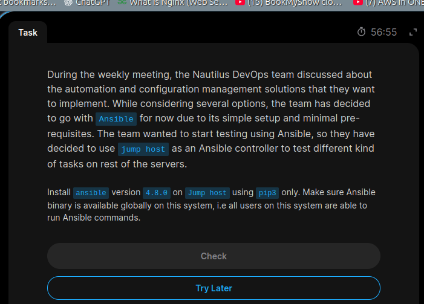
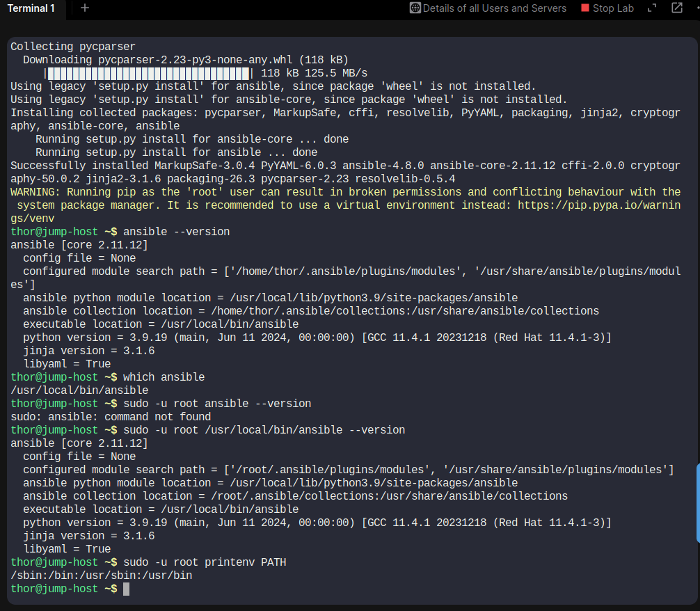

# Day 08 – Install Ansible 4.8.0 Using pip3

## 📌 Task Description

The Nautilus DevOps team required Ansible version **4.8.0** to be installed on the Jump Host.

### Requirements

1. Install Ansible version `4.8.0`.
2. Use `pip3` only for installation.
3. Make the Ansible binary available globally so all users on the system can execute Ansible commands.

---

## 🖥️ Server Information

| Detail | Value |
|---|---|
| Server | Jump Host |
| Hostname | jump-host |
| User | thor |
| Python Version | 3.9.19 |
| pip Version | 21.3.1 |
| Ansible Version | 4.8.0 |
| Ansible Core | 2.11.12 |
| Binary Location | `/usr/local/bin/ansible` |

---

## 🛠️ Implementation Steps

### Step 1: Verify Python and pip3

```bash
python3 --version
pip3 --version
```

Python and pip3 were already installed on the Jump Host.

### Step 2: Check Existing Ansible Installation

```bash
ansible --version
```

Initially, Ansible was not installed.

Output:

```text
bash: ansible: command not found
```

### Step 3: Install Ansible 4.8.0 Using pip3

Executed:

```bash
sudo pip3 install ansible==4.8.0
```

Installation completed successfully.

Important installed packages:

- ansible: 4.8.0
- ansible-core: 2.11.12
- Python: 3.9.19

### Step 4: Verify Ansible Version

```bash
ansible --version
```

Verified output:

```text
ansible [core 2.11.12]
config file = None
ansible python module location = /usr/local/lib/python3.9/site-packages/ansible
executable location = /usr/local/bin/ansible
python version = 3.9.19
```

### Step 5: Verify Ansible Binary Location

```bash
which ansible
```

Output:

```text
/usr/local/bin/ansible
```

### Step 6: Verify Execution as Root

Executed:

```bash
sudo -u root /usr/local/bin/ansible --version
```

Ansible executed successfully as root.

**Note:** Root's default sudo PATH did not include `/usr/local/bin`. Therefore, the command was executed using its absolute path. This was a PATH configuration difference, not an installation failure.

---

## 📸 Screenshots

### Task Question



### Task Solution



---

## 🎯 Final Result

Successfully installed Ansible 4.8.0 on the Jump Host using pip3 only.

- Ansible 4.8.0 installed successfully.
- Installation performed using pip3.
- Binary available at `/usr/local/bin/ansible`.
- Ansible version verified successfully.
- Execution as root verified successfully using the absolute binary path.

**Task Status: Completed ✅**

---

## 📚 Key Learnings

Through this task, I learned:

1. How to install a specific Ansible version using pip3.
2. How to install Python packages system-wide.
3. How to verify Ansible installation.
4. How to locate executable binaries using `which`.
5. The importance of Linux PATH configuration.
6. How to execute Ansible commands as another user.

---

## 🔗 My GitHub Portfolio

[100 Days of DevOps](https://github.com/Shraddha5-stack/100-Days-Of-DevOps)

---
**#100DaysOfDevOps #Ansible #Linux #DevOps #Python #KodeKloud**
