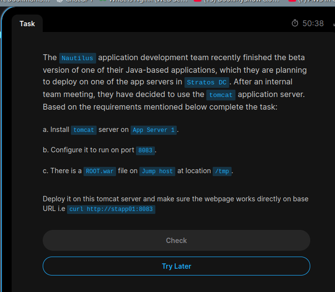
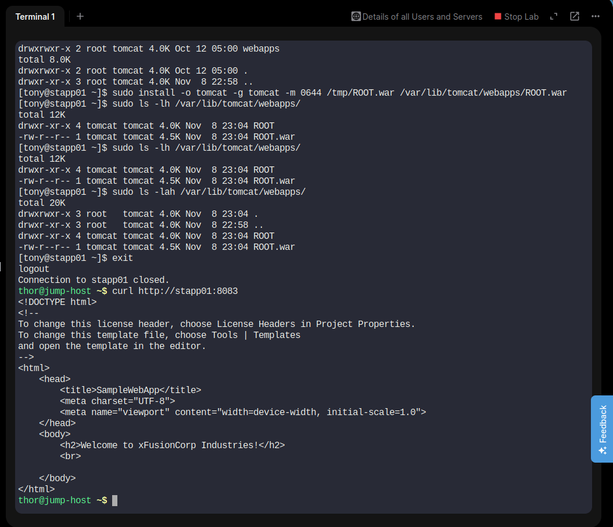

# Day 11 – Install Tomcat and Deploy ROOT.war

## 📌 Objective

Install Apache Tomcat on App Server 1 in the Stratos Datacenter, configure it to listen on port `8083`, deploy the provided `ROOT.war` application, and verify that the application is accessible.

## 🖥️ Server Details

| Detail | Value |
|---|---|
| Server | App Server 1 |
| Hostname | `stapp01` |
| Operating System | CentOS Stream 9 |
| SSH User | `tony` |
| Java Version | OpenJDK 11 |
| Tomcat Version | 9.0.121 |
| HTTP Port | 8083 |
| Application | ROOT.war |

---

## 🔧 Implementation Steps

### 1. Verify Java Installation

```bash
java -version
```

OpenJDK 11 was already installed on the server.

### 2. Install Apache Tomcat

```bash
sudo dnf install tomcat -y
```

### 3. Configure Tomcat Port

Updated the HTTP connector port from `8080` to `8083`.

```bash
sudo sed -i 's/port="8080"/port="8083"/' /etc/tomcat/server.xml
```

Verified the configuration:

```bash
sudo grep -n 'Connector port=' /etc/tomcat/server.xml
```

### 4. Enable and Start Tomcat

```bash
sudo systemctl enable --now tomcat
```

Check service status:

```bash
sudo systemctl status tomcat --no-pager -l
```

Tomcat started successfully.

### 5. Transfer ROOT.war to App Server 1

From the Jump Host:

```bash
scp /tmp/ROOT.war tony@stapp01:/tmp/ROOT.war
```

### 6. Deploy the Application

On App Server 1, deployed the WAR file into Tomcat's webapps directory:

```bash
sudo install -o tomcat -g tomcat -m 0644 /tmp/ROOT.war /var/lib/tomcat/webapps/ROOT.war
```

Verified deployment:

```bash
sudo ls -lah /var/lib/tomcat/webapps/
```

Tomcat automatically extracted the WAR file into the `ROOT` directory.

### 7. Restart Tomcat

```bash
sudo systemctl restart tomcat
```

### 8. Verify Application Accessibility

From the Jump Host:

```bash
curl http://stapp01:8083
```

Expected webpage content:

```html
<h2>Welcome to xFusionCorp Industries!</h2>
```

---

## 📸 Screenshots

### Task Question



### Task Solution



---

## 🎯 Key Learnings

- Installing Apache Tomcat on CentOS Stream 9.
- Understanding Java application server deployment.
- Configuring Tomcat HTTP connector ports.
- Managing Linux services using systemctl.
- Transferring application files using SCP.
- Deploying WAR files into Tomcat webapps.
- Understanding automatic WAR extraction.
- Testing web applications using curl.

---

## ✅ Final Result

Successfully installed Apache Tomcat on App Server 1, configured it to listen on port `8083`, deployed `ROOT.war`, and verified application accessibility using curl.

**Server:** `stapp01`  
**Application:** `ROOT.war`  
**Port:** `8083`  
**Status:** COMPLETED ✅

---

**#100DaysOfDevOps | Linux Administration | Apache Tomcat | Java | Deployment**

