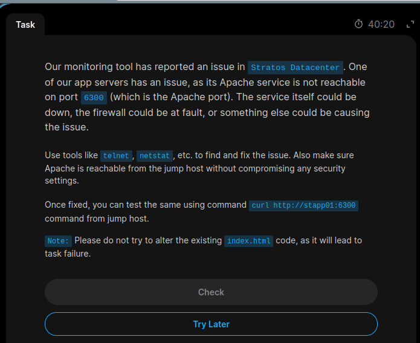
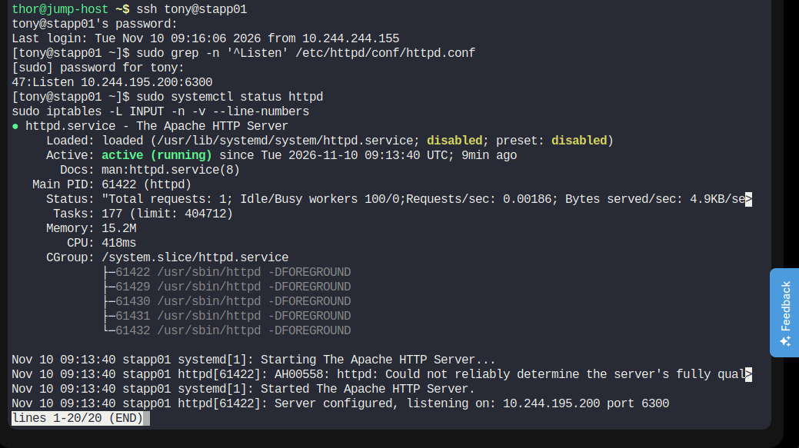
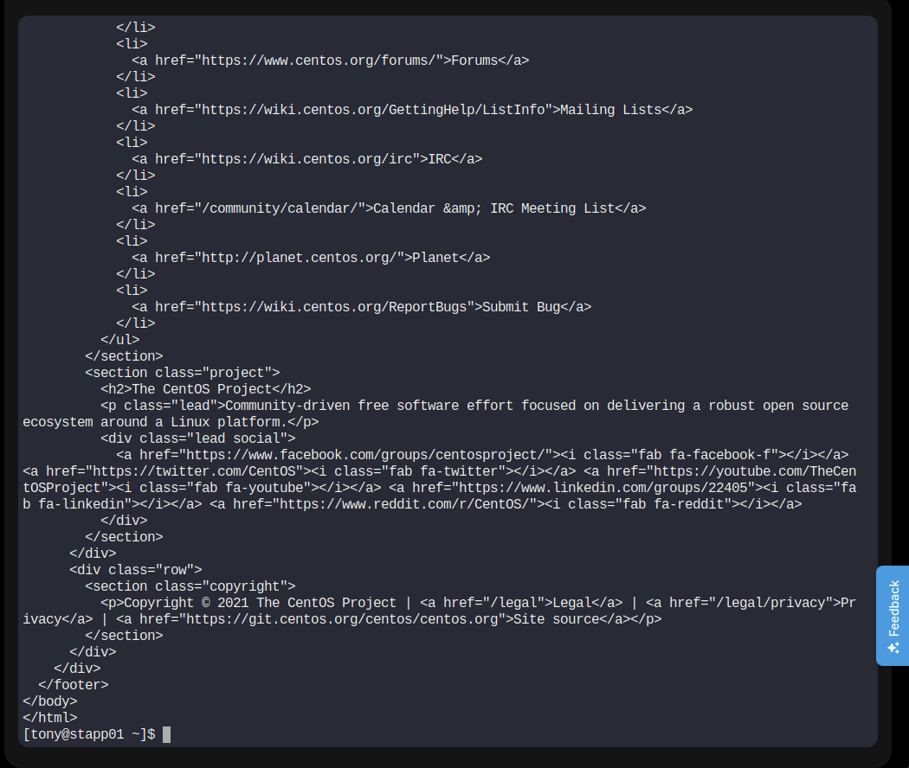

# Day 12 – Linux Network Services

## KodeKloud Engineer | 100 Days of DevOps

### Task: Fix Apache Service Connectivity on Port 6300

## Objective

The Apache service on App Server 1 (`stapp01`) was not reachable from the Jump Host on port `6300`.

The goal was to troubleshoot the issue, restore Apache connectivity, and ensure secure access without modifying the existing `index.html` file.

## Troubleshooting and Implementation

1. Connected to App Server 1 from the Jump Host using SSH.
2. Checked Apache service status using `systemctl`.
3. Identified that Apache failed to start because port `6300` was already in use.
4. Inspected listening ports using `ss -tulnp`.
5. Found Sendmail listening on `127.0.0.1:6300`.
6. Backed up the Apache configuration file.
7. Updated Apache's Listen directive to bind to the application server IP address on port `6300`.
8. Validated Apache configuration.
9. Started Apache successfully.
10. Inspected firewall rules using `iptables`.
11. Configured firewall access for the Jump Host.
12. Tested HTTP connectivity from the Jump Host using `curl`.

## Commands Used

### 1. Check Apache Service

```bash
sudo systemctl status httpd
```

### 2. Check Listening Ports

```bash
sudo ss -tulnp
```

### 3. Back Up Apache Configuration

```bash
sudo cp /etc/httpd/conf/httpd.conf /etc/httpd/conf/httpd.conf.bak
```

### 4. Configure Apache Listen Directive

```bash
sudo vi /etc/httpd/conf/httpd.conf
```

Updated directive:

```apache
Listen 10.244.195.200:6300
```

### 5. Validate Apache Configuration

```bash
sudo httpd -t
```

Expected output:

```text
Syntax OK
```

### 6. Start Apache

```bash
sudo systemctl start httpd
sudo systemctl status httpd
```

### 7. Check Firewall Rules

```bash
sudo iptables -L INPUT -n -v --line-numbers
```

The firewall rule should allow new TCP connections to port `6300` only from the Jump Host IP address (`10.244.244.155`).

### 8. Test Connectivity from Jump Host

```bash
curl http://stapp01:6300
```

## Final Verification

- Apache service started successfully.
- Apache listens on port `6300`.
- Firewall access was configured for the Jump Host.
- HTTP response was received successfully from the Jump Host.
- Existing `index.html` was not modified.

## Screenshots

### Task Description


### Apache Configuration, Service Status and Firewall


### Successful Connectivity Test


## Key Learnings

- Linux service troubleshooting using `systemctl`.
- Identifying port conflicts using `ss`.
- Apache HTTP server configuration.
- Understanding the Apache Listen directive.
- Firewall management using `iptables`.
- Testing HTTP connectivity using `curl`.
- Applying network security by restricting inbound access.

---

**Challenge:** KodeKloud Engineer – 100 Days of DevOps  
**Day:** 12  
**Topic:** Linux Network Services  
**Status:** Completed

