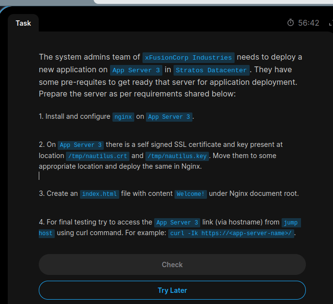
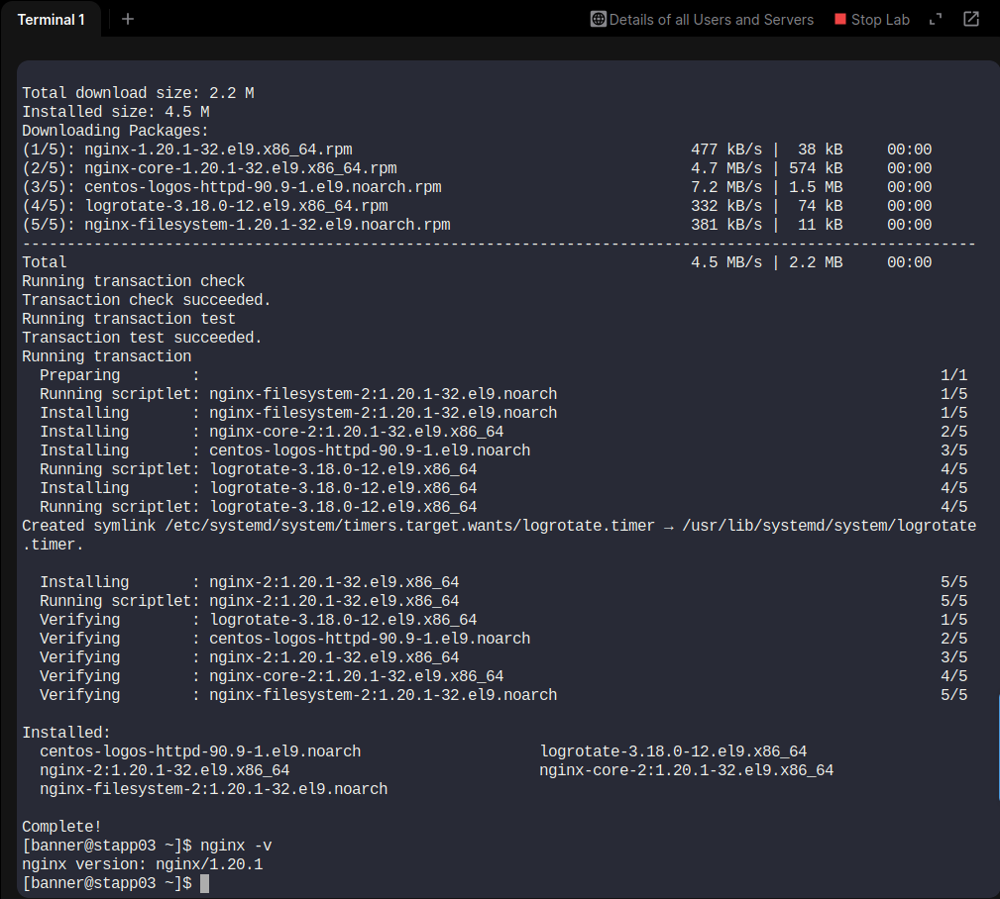
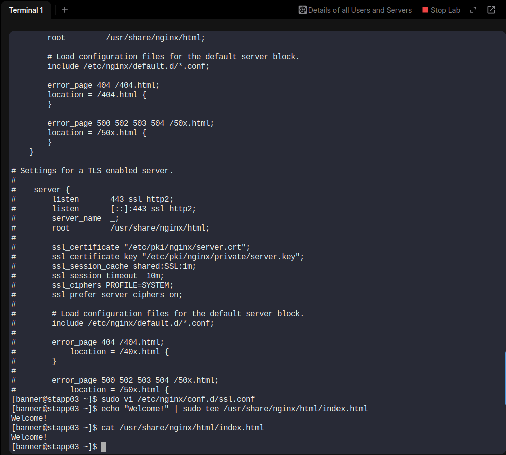
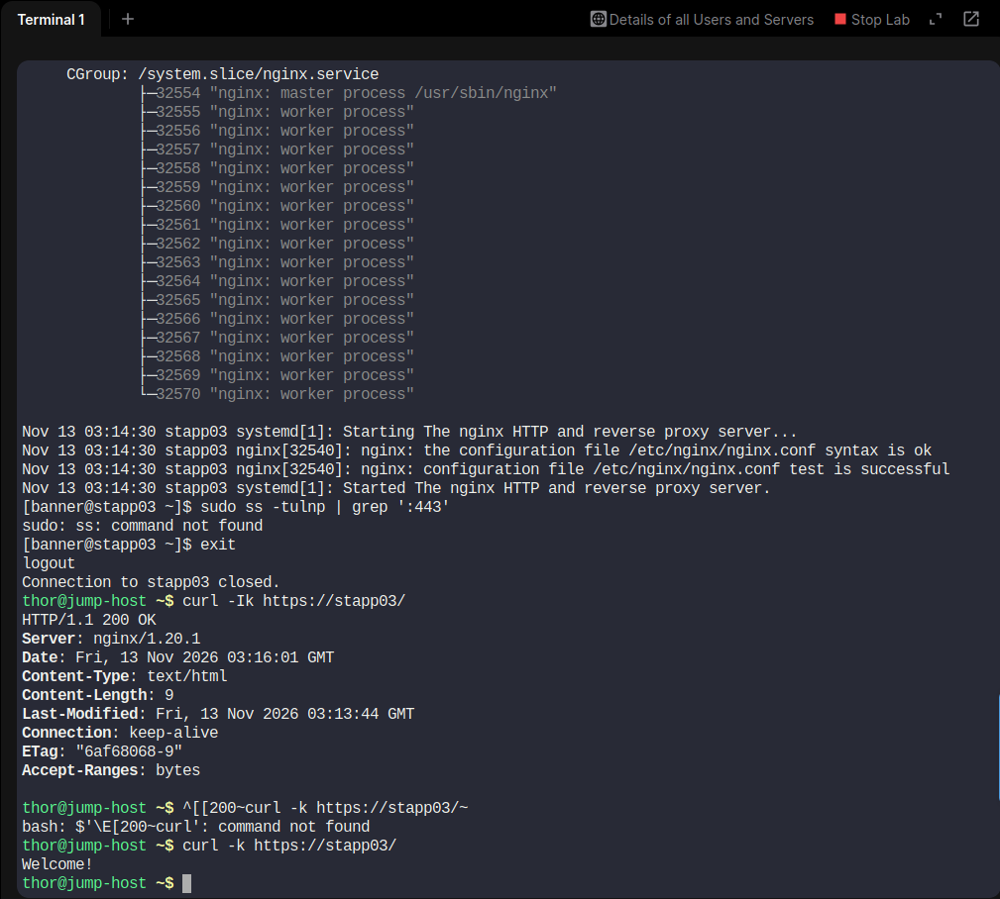

# Day 15 – Install and Configure Nginx with SSL

## 📌 Task Overview

The system administration team at xFusionCorp Industries needed to prepare App Server 3 in the Stratos Datacenter for a new application deployment.

The task involved installing and configuring Nginx, deploying an existing self-signed SSL certificate, creating an index page, and verifying HTTPS connectivity from the Jump Host.

## 🎯 Objectives

- Install and configure Nginx on App Server 3.
- Move the provided SSL certificate and private key to an appropriate location.
- Configure Nginx to use the SSL certificate.
- Create an `index.html` file containing `Welcome!`.
- Verify HTTPS access from the Jump Host.

## 🖥️ Server Details

| Parameter | Details |
|---|---|
| Server | App Server 3 |
| Hostname | stapp03 |
| Operating System | CentOS Stream 9 |
| Web Server | Nginx 1.20.1 |
| HTTPS Port | 443 |
| Document Root | /usr/share/nginx/html |

## 📸 Task Screenshot



## 🛠️ Implementation Steps

### Step 1: Connect to App Server 3

```bash
ssh banner@stapp03
```

Verify hostname:

```bash
hostname
```

### Step 2: Install Nginx

Check the operating system:

```bash
cat /etc/os-release
```

Install Nginx:

```bash
sudo dnf install nginx -y
```

Verify installation:

```bash
nginx -v
```

### Step 3: Check SSL Certificate and Key

The provided certificate and key were available at:

```text
/tmp/nautilus.crt
/tmp/nautilus.key
```

Verify the files:

```bash
sudo ls -l /tmp/nautilus.crt /tmp/nautilus.key
```

### Step 4: Move SSL Files

Create an SSL directory:

```bash
sudo mkdir -p /etc/nginx/ssl
```

Move the certificate and private key:

```bash
sudo mv /tmp/nautilus.crt /etc/nginx/ssl/
sudo mv /tmp/nautilus.key /etc/nginx/ssl/
```

Set appropriate permissions:

```bash
sudo chmod 644 /etc/nginx/ssl/nautilus.crt
sudo chmod 600 /etc/nginx/ssl/nautilus.key
```

Verify:

```bash
sudo ls -l /etc/nginx/ssl/
```

### Step 5: Configure Nginx for HTTPS

Create the SSL configuration file:

```bash
sudo vi /etc/nginx/conf.d/ssl.conf
```

Add the following configuration:

```nginx
server {
    listen 443 ssl;
    listen [::]:443 ssl;
    server_name stapp03;

    root /usr/share/nginx/html;
    index index.html;

    ssl_certificate /etc/nginx/ssl/nautilus.crt;
    ssl_certificate_key /etc/nginx/ssl/nautilus.key;

    location / {
        try_files $uri $uri/ =404;
    }
}
```

### Step 6: Create index.html

Create the required HTML page:

```bash
echo "Welcome!" | sudo tee /usr/share/nginx/html/index.html
```

Verify the content:

```bash
cat /usr/share/nginx/html/index.html
```

Expected output:

```text
Welcome!
```

### Step 7: Test and Start Nginx

Test the Nginx configuration:

```bash
sudo nginx -t
```

Enable and start Nginx:

```bash
sudo systemctl enable --now nginx
```

Check service status:

```bash
sudo systemctl status nginx
```

Expected status:

```text
Active: active (running)
```

## 📸 Solution Screenshots

### Solution 1 – Nginx Installation and SSL Certificate Setup



### Solution 2 – Nginx HTTPS Configuration and HTML Page



### Solution 3 – Service Verification and HTTPS Testing



## 🧪 Final Verification from Jump Host

Exit App Server 3:

```bash
exit
```

Test HTTPS connectivity:

```bash
curl -Ik https://stapp03/
```

Successful response:

```text
HTTP/1.1 200 OK
Server: nginx/1.20.1
```

Verify webpage content:

```bash
curl -k https://stapp03/
```

Expected output:

```text
Welcome!
```

**Note:** The `-k` option allows curl to connect without verifying the self-signed certificate against a trusted Certificate Authority.

## 📚 Key Learnings

- Installing Nginx on CentOS Stream 9 using DNF.
- Configuring Nginx server blocks.
- Deploying SSL certificates and private keys.
- Understanding HTTPS and SSL configuration.
- Managing Linux services using systemctl.
- Setting secure permissions for private keys.
- Testing HTTPS connectivity using curl.

## ✅ Task Status

**Completed Successfully!**

Nginx was installed and configured on App Server 3 with the provided self-signed SSL certificate. HTTPS connectivity was verified successfully from the Jump Host, returning HTTP 200 OK and the expected `Welcome!` content.

---

**Challenge

