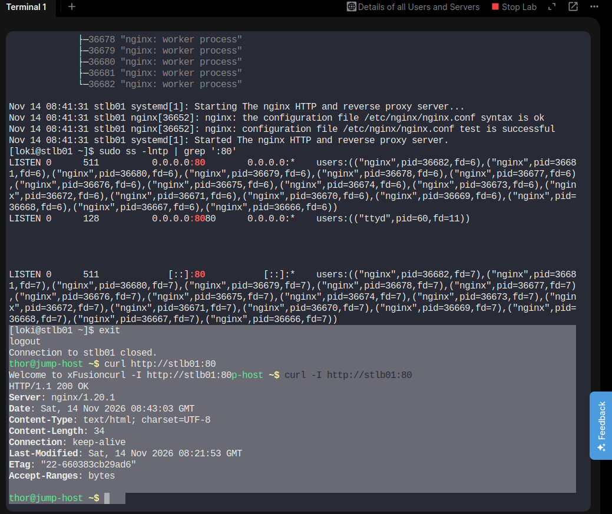
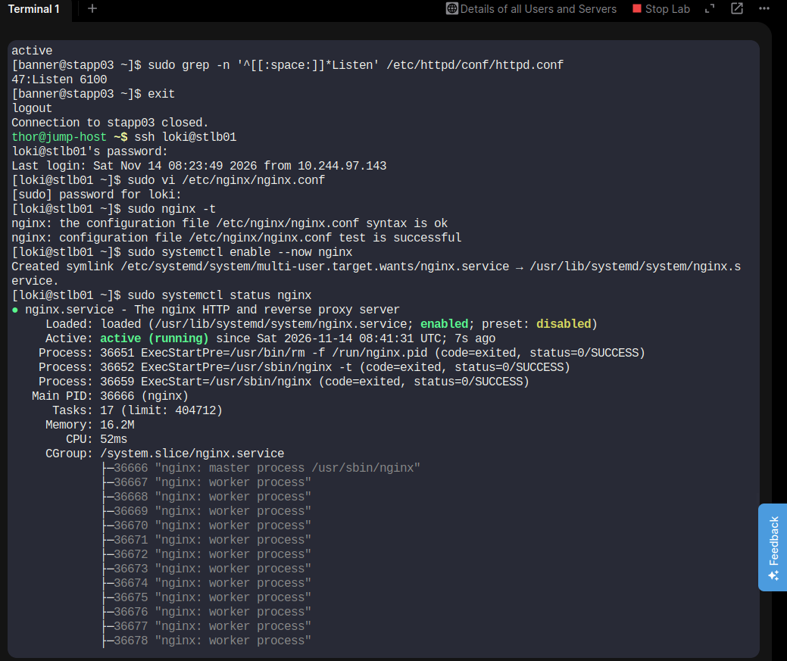
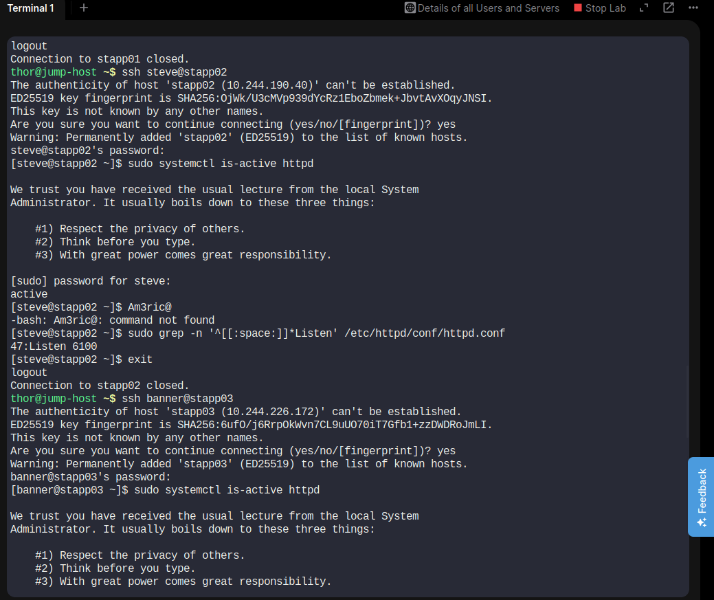
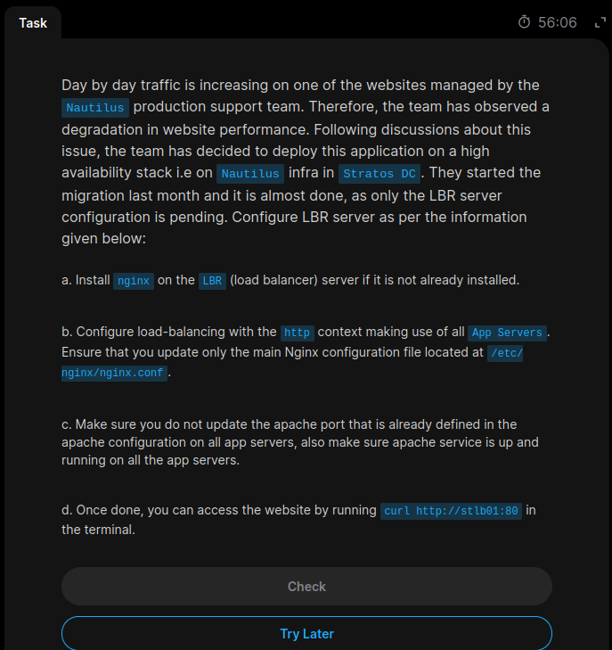
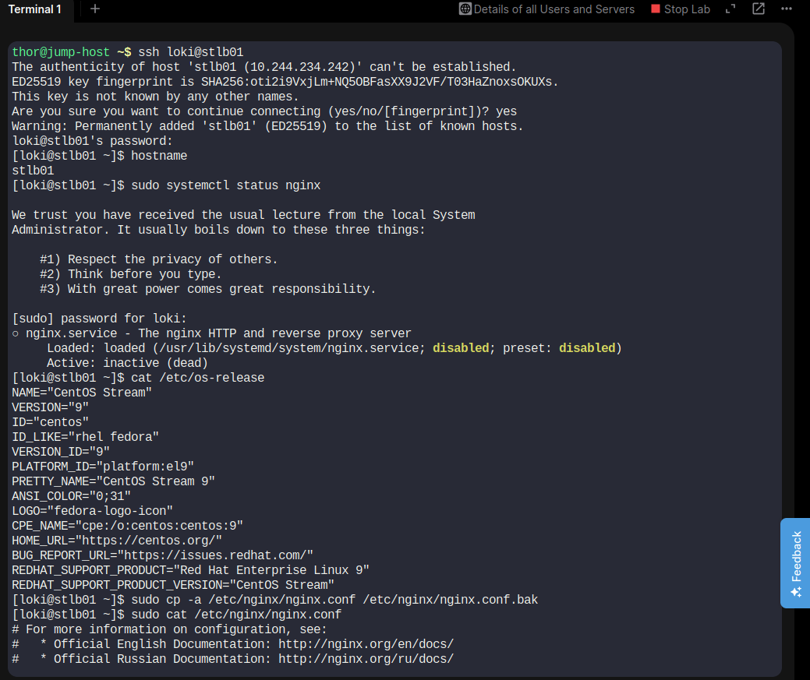
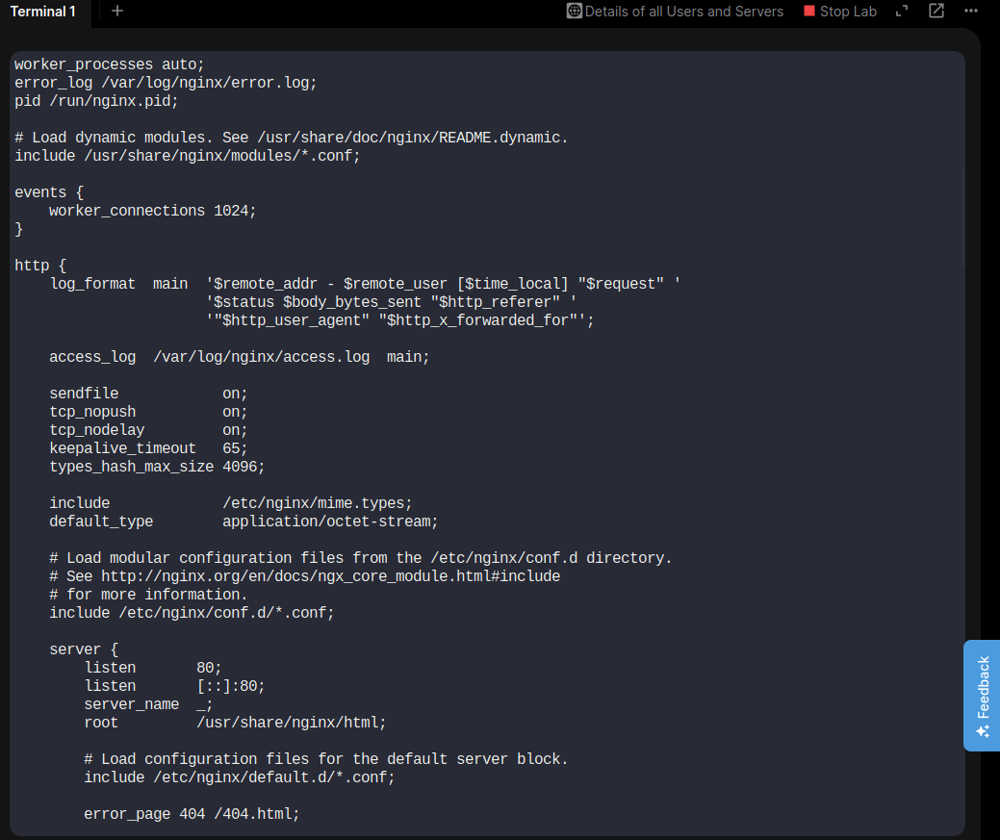
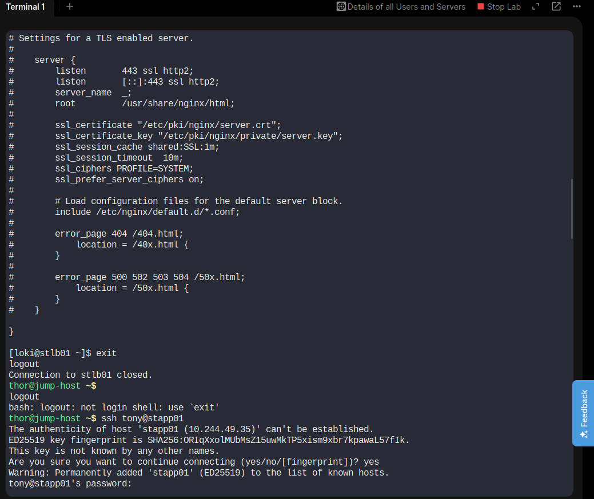
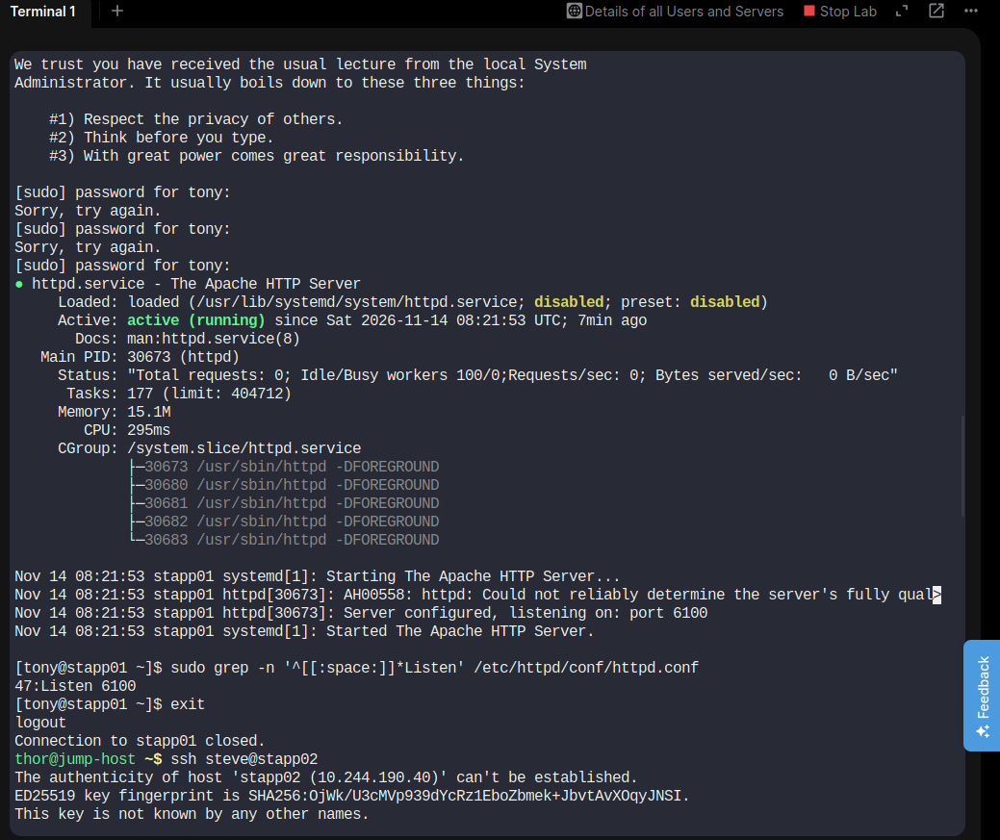

# Day 16 – Configure Nginx as a Load Balancer

## 📌 Task Objective

Configure Nginx on the Load Balancer (LBR) server to distribute incoming HTTP traffic across three Apache application servers.

The objective is to build a highly available application architecture using Nginx as a reverse proxy and load balancer.

## 🏗️ Infrastructure Details

| Component | Hostname | IP Address | Port |
|---|---|---|---|
| Load Balancer | stlb01 | 10.244.234.242 | 80 |
| App Server 1 | stapp01 | 10.244.49.35 | 6100 |
| App Server 2 | stapp02 | 10.244.190.40 | 6100 |
| App Server 3 | stapp03 | 10.244.226.172 | 6100 |

## 🛠️ Implementation Steps

### Step 1: Connect to Load Balancer

```bash
ssh loki@stlb01
```

Check the Nginx service:

```bash
sudo systemctl status nginx
```

Nginx was already installed but initially inactive.

### Step 2: Verify Apache on All Application Servers

Checked Apache service status:

```bash
sudo systemctl is-active httpd
```

Checked Apache listening port:

```bash
sudo grep -n '^[[:space:]]*Listen' /etc/httpd/conf/httpd.conf
```

Verification:

- stapp01 – Active, Port 6100
- stapp02 – Active, Port 6100
- stapp03 – Active, Port 6100

**Note:** Existing Apache ports were preserved. No changes were made to the application server Apache configurations.

### Step 3: Back Up Nginx Configuration

Created a backup of the main Nginx configuration file:

```bash
sudo cp -a /etc/nginx/nginx.conf /etc/nginx/nginx.conf.bak
```

### Step 4: Configure Nginx Load Balancing

Edited the main Nginx configuration:

```bash
sudo vi /etc/nginx/nginx.conf
```

Added the following upstream configuration inside the existing `http` context:

```nginx
upstream nautilus_backend {
    server 10.244.49.35:6100;
    server 10.244.190.40:6100;
    server 10.244.226.172:6100;
}
```

Configured the Nginx server block:

```nginx
server {
    listen 80;
    listen [::]:80;
    server_name stlb01;

    location / {
        proxy_pass http://nautilus_backend;
        proxy_set_header Host $host;
        proxy_set_header X-Real-IP $remote_addr;
        proxy_set_header X-Forwarded-For $proxy_add_x_forwarded_for;
    }
}
```

### Step 5: Validate Nginx Configuration

Executed:

```bash
sudo nginx -t
```

Output:

```text
nginx: the configuration file /etc/nginx/nginx.conf syntax is ok
nginx: configuration file /etc/nginx/nginx.conf test is successful
```

### Step 6: Enable and Start Nginx

Executed:

```bash
sudo systemctl enable --now nginx
```

Verified service status:

```bash
sudo systemctl status nginx
```

Result:

```text
Active: active (running)
```

### Step 7: Verify Nginx Listening Port

Executed:

```bash
sudo ss -lntp | grep ':80'
```

Confirmed that Nginx was listening on port 80.

### Step 8: Test Load Balancer from Jump Host

Executed:

```bash
curl http://stlb01:80
```

Output:

```text
Welcome to xFusion
```

Checked HTTP response:

```bash
curl -I http://stlb01:80
```

Output:

```text
HTTP/1.1 200 OK
Server: nginx/1.20.1
Content-Type: text/html; charset=UTF-8
```

Successfully received an HTTP 200 OK response through the Nginx load balancer.

## 📸 Screenshots and Evidence

### 1. Task Description



### 2. Solution Evidence – 01



### 3. Solution Evidence – 02



### 4. Solution Evidence – 03



### 5. Solution Evidence – 04



### 6. Solution Evidence – 05



### 7. Solution Evidence – 06



### 8. Solution Evidence – 07



## 📚 Key Learnings

During this task, I practiced:

- Nginx installation and configuration.
- Nginx as a reverse proxy and load balancer.
- Configuring upstream backend servers.
- Round-robin load balancing.
- Reverse proxy headers.
- Apache service verification.
- Linux service management using systemctl.
- Nginx configuration validation using `nginx -t`.
- HTTP connectivity testing using curl.
- Working with multiple application servers.

## ✅ Final Result

Successfully configured Nginx as a load balancer on `stlb01`.

- Three Apache backend servers configured.
- All three Apache services verified active.
- Existing Apache port 6100 preserved.
- Nginx successfully enabled and started.
- Nginx listening on port 80.
- HTTP connectivity successfully verified.
- Final response: **HTTP 200 OK**.

**Platform:** KodeKloud Engineer – 100 Days of DevOps  
**Day:** 16  
**Technologies:** Linux | Nginx | Apache | Reverse Proxy | Load Balancing
