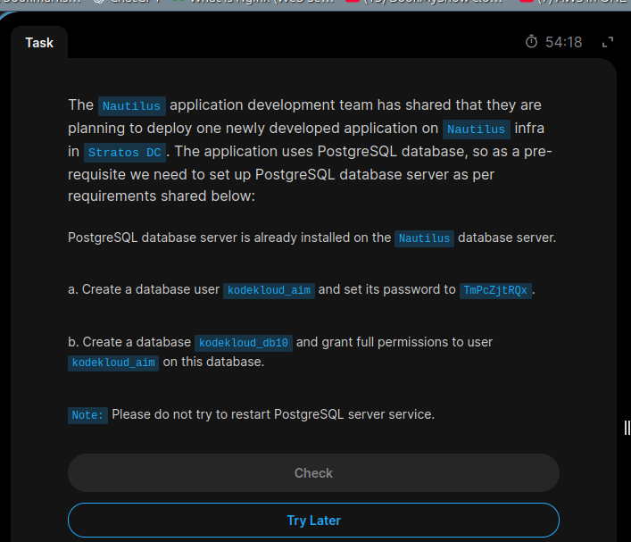
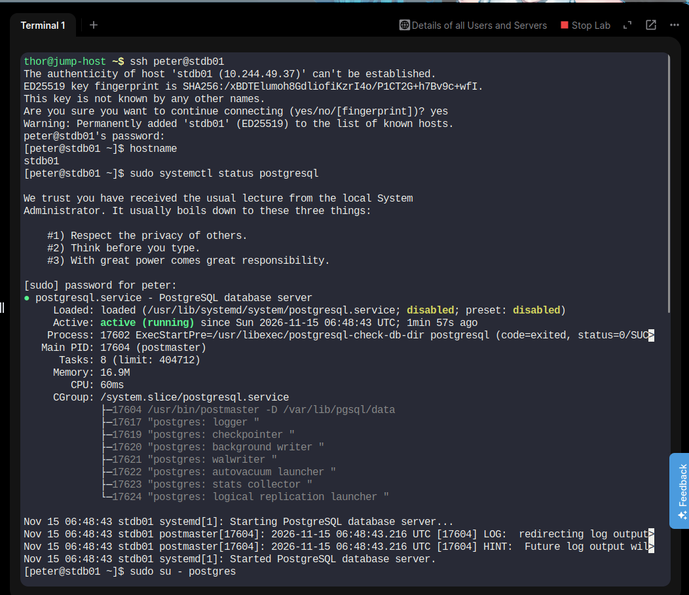
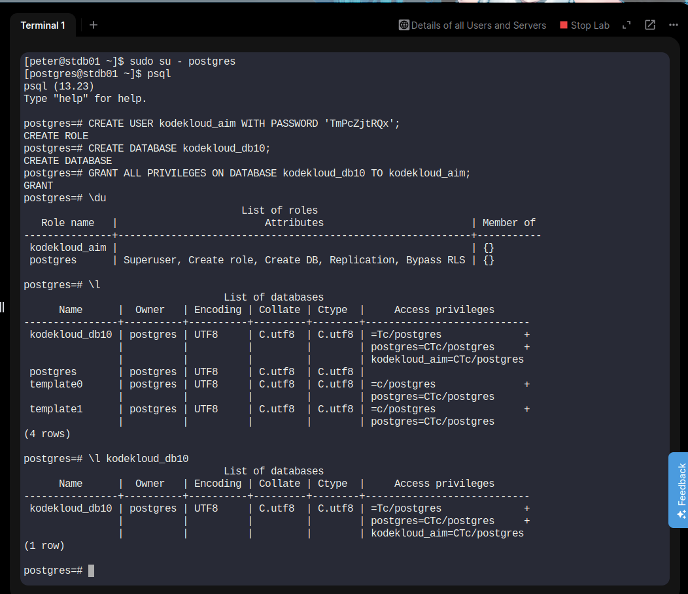

# Day 17 – PostgreSQL User and Database Setup

## 📌 Task Objective

The Nautilus application development team planned to deploy a new application on the Nautilus infrastructure in Stratos DC.

The application requires a PostgreSQL database server.

The task was to create a PostgreSQL database user, create a database, and grant the required permissions.

## 🖥️ Server Details

| Component | Details |
|---|---|
| Server | Nautilus Database Server |
| Hostname | stdb01 |
| Server User | peter |
| Database | PostgreSQL |
| PostgreSQL Version | 13.23 |

## 📋 Requirements

1. Create a PostgreSQL user named `kodekloud_aim`.
2. Set the password to the provided task password.
3. Create a database named `kodekloud_db10`.
4. Grant all database-level privileges to `kodekloud_aim`.
5. Do not restart the PostgreSQL service.

## 🛠️ Implementation Steps

### Step 1: Connect to the Database Server

Connected to the Nautilus Database Server from the Jump Host:

```bash
ssh peter@stdb01
```

Verified the hostname:

```bash
hostname
```

Output:

```text
stdb01
```

### Step 2: Check PostgreSQL Service Status

Executed:

```bash
sudo systemctl status postgresql
```

Verified that PostgreSQL was already running.

```text
Active: active (running)
```

**Note:** The PostgreSQL service was not restarted.

### Step 3: Switch to PostgreSQL User

Switched to the PostgreSQL system account:

```bash
sudo su - postgres
```

Opened the PostgreSQL interactive terminal:

```bash
psql
```

Successfully accessed the PostgreSQL prompt:

```text
postgres=#
```

### Step 4: Create the Database User

Executed:

```sql
CREATE USER kodekloud_aim WITH PASSWORD '<TASK_PASSWORD>';
```

Output:

```text
CREATE ROLE
```

The PostgreSQL user was created successfully.

### Step 5: Create the Database

Executed:

```sql
CREATE DATABASE kodekloud_db10;
```

Output:

```text
CREATE DATABASE
```

The database was created successfully.

### Step 6: Grant Database Privileges

Granted all database-level privileges to the newly created user:

```sql
GRANT ALL PRIVILEGES ON DATABASE kodekloud_db10 TO kodekloud_aim;
```

Output:

```text
GRANT
```

### Step 7: Verify PostgreSQL User

Executed:

```sql
\du
```

Verified that `kodekloud_aim` appeared in the PostgreSQL roles list.

### Step 8: Verify Database and Permissions

Executed:

```sql
\l
```

Confirmed that `kodekloud_db10` was created.

Checked its access privileges:

```sql
\l kodekloud_db10
```

Verified the privilege entry:

```text
kodekloud_aim=CTc/postgres
```

This confirms the database-level privileges:

- CONNECT
- CREATE
- TEMPORARY

## 📸 Screenshots and Evidence

### 1. Task Description



### 2. PostgreSQL User and Database Configuration



### 3. PostgreSQL Permissions Verification



## 📚 Key Learnings

Through this task, I practiced:

- Connecting to a remote Linux server using SSH.
- Checking PostgreSQL service status using systemctl.
- Switching to the PostgreSQL system user.
- Accessing PostgreSQL using `psql`.
- Creating database users with passwords.
- Creating PostgreSQL databases.
- Granting database-level privileges.
- Verifying users and permissions using PostgreSQL meta-commands.

## ✅ Final Result

Successfully completed the PostgreSQL database setup on the Nautilus Database Server.

| Requirement | Status |
|---|---|
| PostgreSQL service running | ✅ |
| User `kodekloud_aim` created | ✅ |
| Database `kodekloud_db10` created | ✅ |
| Database privileges granted | ✅ |
| Permissions verified | ✅ |
| PostgreSQL service restarted | ❌ Not required |

**Platform:** KodeKloud Engineer – 100 Days of DevOps  
**Day:** 17  
**Technology:** Linux | PostgreSQL | SQL | Database Administration
