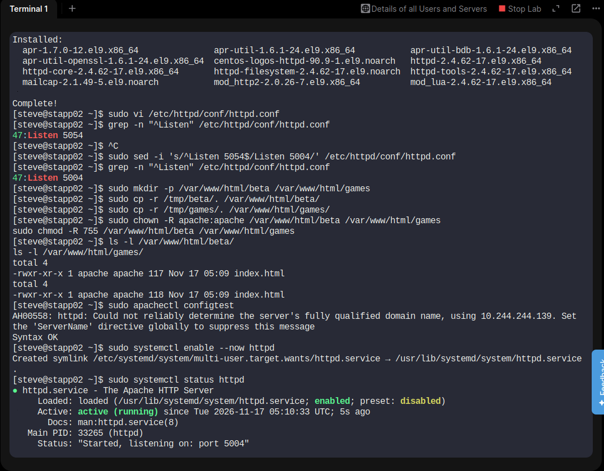
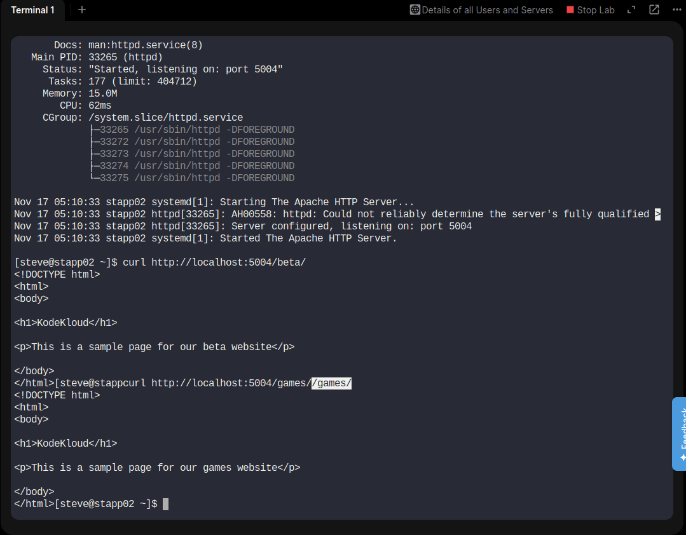

# Day 19 – Host Multiple Static Websites Using Apache

## 📌 Task Overview

The objective was to host two static websites, `beta` and `games`, on App Server 2 using Apache HTTP Server.

Both websites must be accessible through separate URL paths on port `5004`.

## 🖥️ Environment Details

| Component | Details |
|---|---|
| Server | App Server 2 |
| Hostname | stapp02 |
| Linux Distribution | CentOS Stream 9 |
| Web Server | Apache (httpd) |
| Apache Port | 5004 |
| Website 1 | beta |
| Website 2 | games |

## 🎯 Task Requirements

1. Install Apache (`httpd`) and its dependencies on App Server 2.
2. Configure Apache to listen on port `5004`.
3. Copy the website backup directories from the Jump Host to App Server 2.
4. Configure both websites:
   - `http://localhost:5004/beta/`
   - `http://localhost:5004/games/`
5. Verify both websites using `curl`.

## 🛠️ Implementation Steps

### 1. Connect to App Server 2

```bash
ssh steve@stapp02
```

### 2. Install Apache

```bash
sudo yum install httpd -y
```

### 3. Configure Apache to Listen on Port 5004

Edit the Apache configuration:

```bash
sudo vi /etc/httpd/conf/httpd.conf
```

Change the Listen directive:

```apache
Listen 5004
```

Verify the configuration:

```bash
grep -n "^Listen" /etc/httpd/conf/httpd.conf
```

### 4. Copy Website Files

The `beta` and `games` backup directories were transferred from the Jump Host to App Server 2 using SCP.

```bash
scp -r /home/thor/beta steve@stapp02:/tmp/
scp -r /home/thor/games steve@stapp02:/tmp/
```

### 5. Create Website Directories

```bash
sudo mkdir -p /var/www/html/beta
sudo mkdir -p /var/www/html/games
```

### 6. Copy Website Content

```bash
sudo cp -r /tmp/beta/. /var/www/html/beta/
sudo cp -r /tmp/games/. /var/www/html/games/
```

### 7. Set Ownership and Permissions

```bash
sudo chown -R apache:apache /var/www/html/beta /var/www/html/games

sudo chmod -R 755 /var/www/html/beta /var/www/html/games
```

### 8. Validate Apache Configuration

```bash
sudo apachectl configtest
```

Expected output:

```text
Syntax OK
```

### 9. Enable and Start Apache

```bash
sudo systemctl enable --now httpd
```

Check service status:

```bash
sudo systemctl status httpd
```

Expected status:

```text
Active: active (running)
```

### 10. Verify Both Websites

Test the beta website:

```bash
curl http://localhost:5004/beta/
```

Expected content:

```html
<h1>KodeKloud</h1>
<p>This is a sample page for our beta website</p>
```

Test the games website:

```bash
curl http://localhost:5004/games/
```

Expected content:

```html
<h1>KodeKloud</h1>
<p>This is a sample page for our games website</p>
```

## 📸 Screenshots

### Solution 1 – Apache Configuration and Website Setup



### Solution 2 – Website Verification Using curl



## ✅ Final Result

- Apache installed successfully on App Server 2.
- Apache configured to listen on port `5004`.
- Both static website directories configured.
- Correct ownership and permissions applied.
- Apache service enabled and running.
- Both websites successfully verified using `curl`.

**Task Status: Completed Successfully!**

## 📚 Key Learnings

- Installing and configuring Apache on Linux.
- Changing the Apache listening port.
- Transferring files between Linux servers using SCP.
- Configuring multiple static websites using directory paths.
- Managing Linux ownership and permissions.
- Validating Apache configuration and service status.
- Testing web applications using `curl`.

---

**Day 19 of my 100 Days of DevOps journey. Learning by doing, troubleshooting, and documenting! 🚀**

