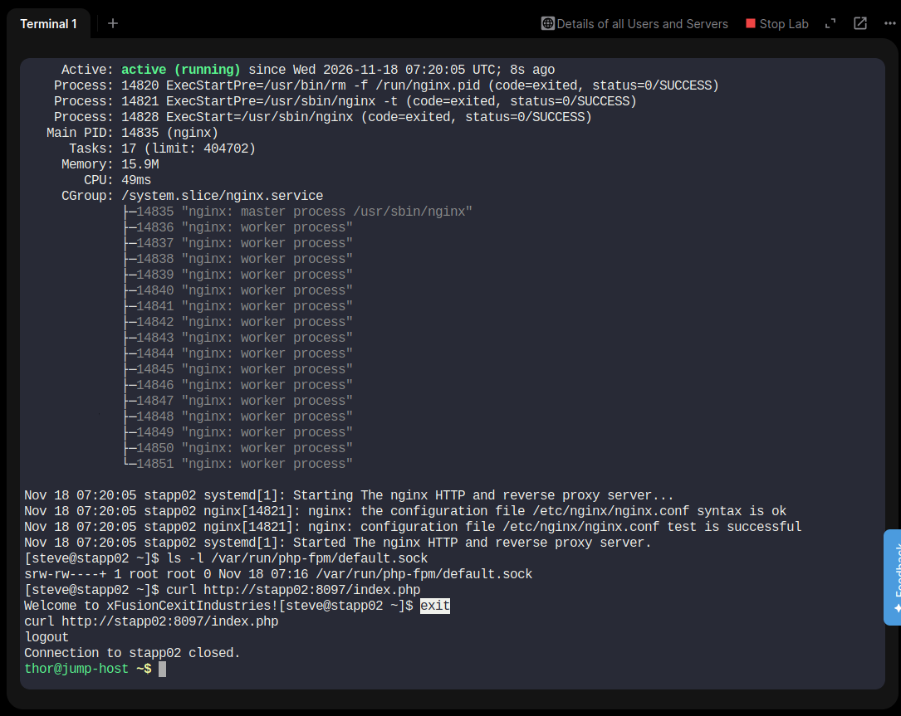
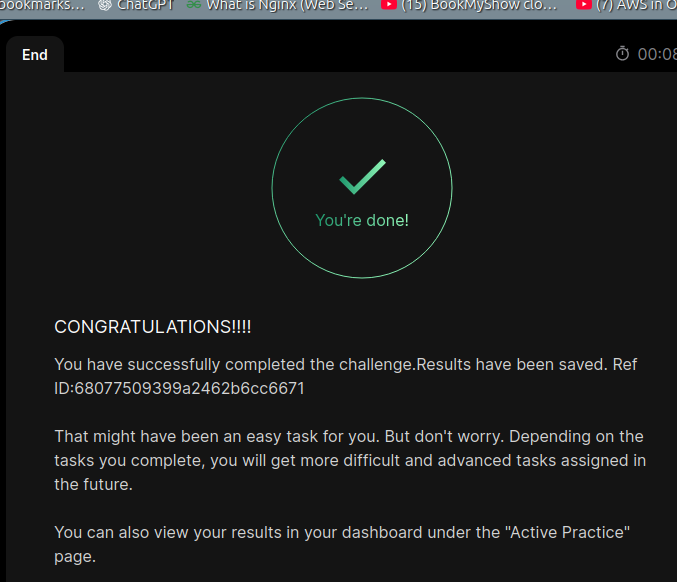

# Day 20 – Configure Nginx with PHP-FPM

## 📌 Task Overview

The Nautilus development team needed to deploy a PHP-based application on App Server 2 in the Stratos Datacenter.

The objective was to install and configure Nginx and PHP-FPM so that Nginx could process PHP files using a Unix socket.

## 🎯 Requirements

- Install Nginx on App Server 2.
- Configure Nginx to listen on port `8097`.
- Set the document root to `/var/www/html`.
- Install PHP-FPM version `8.1`.
- Configure PHP-FPM to use `/var/run/php-fpm/default.sock`.
- Integrate Nginx with PHP-FPM.
- Verify the PHP application from the Jump Host.

## 🖥️ Environment Details

| Component | Details |
|---|---|
| Server | App Server 2 (`stapp02`) |
| Operating System | CentOS Stream 9 |
| Web Server | Nginx |
| Nginx Port | 8097 |
| PHP Version | 8.1.27 |
| PHP Process Manager | PHP-FPM |
| PHP-FPM Socket | `/var/run/php-fpm/default.sock` |
| Document Root | `/var/www/html` |

## ⚙️ Implementation Steps

### 1. Install Nginx

```bash
sudo dnf install nginx -y
```

### 2. Enable PHP 8.1 and install PHP-FPM

```bash
sudo dnf module enable php:8.1 -y
sudo dnf install php-fpm php-cli -y
php -v
```

### 3. Configure PHP-FPM

Edited:

```bash
sudo vi /etc/php-fpm.d/www.conf
```

Updated the pool configuration:

```ini
user = nginx
group = nginx

listen = /var/run/php-fpm/default.sock

listen.owner = nginx
listen.group = nginx
listen.mode = 0660
```

Created the socket directory:

```bash
sudo mkdir -p /var/run/php-fpm
sudo chmod 755 /var/run/php-fpm
```

Validated and started PHP-FPM:

```bash
sudo php-fpm -t
sudo systemctl enable --now php-fpm
```

### 4. Configure Nginx

Created:

```bash
sudo vi /etc/nginx/conf.d/php-app.conf
```

Configuration:

```nginx
server {
    listen 8097;
    server_name stapp02;

    root /var/www/html;
    index index.php index.html;

    location / {
        try_files $uri $uri/ =404;
    }

    location ~ \.php$ {
        fastcgi_pass unix:/var/run/php-fpm/default.sock;
        fastcgi_index index.php;
        fastcgi_param SCRIPT_FILENAME $document_root$fastcgi_script_name;
        include fastcgi_params;
    }
}
```

Validated and started Nginx:

```bash
sudo nginx -t
sudo systemctl enable --now nginx
```

## ✅ Verification

PHP-FPM service:

```bash
sudo systemctl status php-fpm
```

Nginx service:

```bash
sudo systemctl status nginx
```

PHP-FPM socket:

```bash
ls -l /var/run/php-fpm/default.sock
```

Tested the application:

```bash
curl http://stapp02:8097/index.php
```

Expected response:

```text
Welcome to xFusionCorp Industries!
```

The application responded successfully, confirming that Nginx and PHP-FPM were integrated correctly.

## 📸 Screenshots

### Solution Evidence





## 📚 Key Learnings

- Installed and configured Nginx on CentOS Stream 9.
- Installed PHP 8.1 and PHP-FPM.
- Learned how PHP-FPM processes PHP requests.
- Configured Nginx to communicate with PHP-FPM through a Unix socket.
- Understood the role of FastCGI in connecting a web server with PHP-FPM.
- Tested a PHP application using curl.

## 🏁 Result

Successfully configured Nginx on port `8097` with document root `/var/www/html` and integrated PHP-FPM 8.1 through the required Unix socket.

**Status: Completed ✅**


