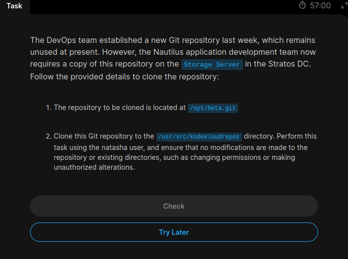
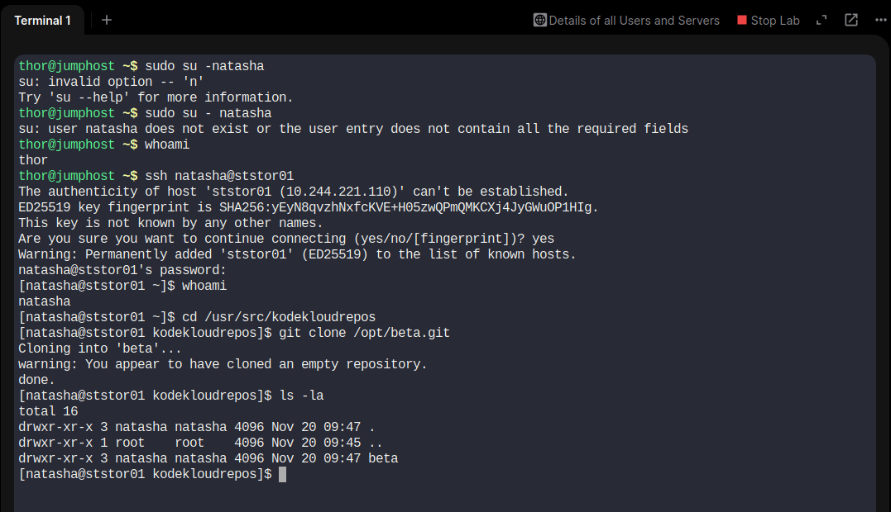

# Day 21 – Clone a Git Repository

## 📌 Objective

Learn how to clone an existing Git repository from a remote or local repository path into a specified directory on a Linux server.

## 📝 Task Description

The Nautilus application development team required a copy of a newly created Git repository on the Storage Server in the Stratos Datacenter.

The following requirements were provided:

- **Source Repository:** `/opt/beta.git`
- **Destination Directory:** `/usr/src/kodekloudrepos`
- **Required User:** `natasha`
- **Server:** Storage Server (`ststor01`)

The task was to clone the repository without modifying the source repository or changing permissions of existing directories.

## 🛠️ Solution

### Step 1: Connect to the Storage Server

From the Jump Host, connect to the Storage Server:

```bash
ssh natasha@ststor01
```

### Step 2: Verify the Current User

```bash
whoami
```

Expected output:

```text
natasha
```

### Step 3: Navigate to the Destination Directory

```bash
cd /usr/src/kodekloudrepos
```

Verify the current working directory:

```bash
pwd
```

Expected output:

```text
/usr/src/kodekloudrepos
```

### Step 4: Clone the Git Repository

Execute the following command:

```bash
git clone /opt/beta.git
```

This command creates a local working copy of the source repository inside the destination directory.

### Step 5: Verify the Cloned Repository

```bash
ls -la
```

Expected directory structure:

```text
/usr/src/kodekloudrepos/
└── beta/
```

Navigate into the cloned repository:

```bash
cd beta
```

Check the repository status:

```bash
git status
```

## 📚 Commands Explained

| Command | Description |
|---|---|
| `ssh` | Connects to a remote server securely. |
| `whoami` | Displays the current logged-in user. |
| `pwd` | Displays the current working directory. |
| `cd` | Changes the current directory. |
| `git clone` | Creates a local copy of an existing Git repository. |
| `ls -la` | Lists files, directories, and hidden files. |
| `git status` | Displays the current Git working tree status. |

## 💡 Important Git Concepts

**What is Git Clone?**

`git clone` is a Git command used to create a local copy of an existing repository.

It downloads the repository's Git history and working files into a new directory.

**What is a Bare Repository?**

A bare Git repository contains Git version-control data without a checked-out working tree.

Bare repositories are commonly used as centralized repositories for collaboration.

## 🌍 Real-World DevOps Use Case

In real-world DevOps environments, developers and DevOps engineers frequently clone Git repositories to:

- Access application source code.
- Configure CI/CD pipelines.
- Build and test applications.
- Deploy applications to development, staging, and production environments.
- Collaborate with other team members.

For example, a Jenkins pipeline can retrieve application code from a Git repository before starting the build process.

## 📸 Screenshots

### 1. Task Description



### 2. Solution



## 🎯 Key Learnings

- Understood how to clone a Git repository.
- Learned how to connect to a remote Linux server using SSH.
- Practised executing commands as a specific Linux user.
- Understood the difference between a bare repository and a working repository.
- Learned how Git cloning is used in DevOps workflows.

---

**Challenge:** 100 Days of DevOps  
**Day:** 21  
**Topic:** Git – Clone Repository  
**Status:** Completed ✅

