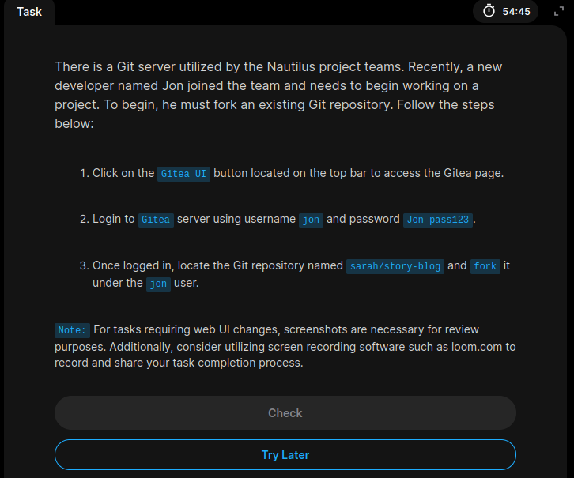
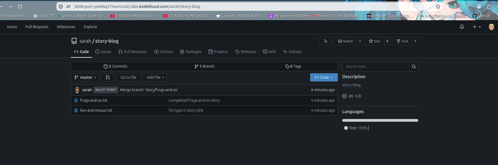

# Day 23 – Fork a Git Repository using Gitea

## 📌 Objective

Understand how to fork an existing Git repository using the Gitea platform.

## 📝 Task Description

The Nautilus project team uses a Git server for source code management. A new developer, Jon, joined the team and needed a personal copy of an existing repository to start working on the project.

**Task Requirements:**

- Platform: Gitea
- Username: `jon`
- Source Repository: `sarah/story-blog`
- Target Owner: `jon`
- Repository Name: `story-blog`

## 🛠️ Implementation

### Step 1: Access Gitea

- Open the KodeKloud lab environment.
- Click on the Gitea UI button.
- Access the Gitea login page.

### Step 2: Login to Gitea

Use the provided credentials:

- Username: `jon`
- Password: Provided lab credentials.

### Step 3: Locate the Repository

Find the existing repository:

```text
sarah/story-blog
```

Open the repository and click the **Fork** button.

### Step 4: Configure the Fork

Configure the repository fork:

| Setting | Value |
|---|---|
| Owner | jon |
| Fork From | sarah/story-blog |
| Repository Name | story-blog |
| Description | story blog |
| Visibility | Inherited from original repository |

Click **Fork Repository** to complete the operation.

### Step 5: Verify the Fork

After successful completion, the new repository is available under Jon's account:

```text
jon/story-blog
```

## 📚 Git Concepts Explained

### What is Git Fork?

Forking is the process of creating a personal copy of another user's repository under your own account on a Git hosting platform.

It allows developers to work independently without directly modifying the original repository.

### Why Do We Use Forking?

- To contribute to open-source projects.
- To develop new features independently.
- To experiment with code safely.
- To submit changes through Pull Requests.
- To collaborate with development teams.

### Difference Between Git Fork and Git Clone

| Git Fork | Git Clone |
|---|---|
| Creates a copy under your hosting account. | Downloads a repository to your local machine. |
| Performed on platforms like Gitea and GitHub. | Performed using the Git command line. |
| Useful for independent contributions. | Useful for local development. |

## 🌍 Real-World DevOps Use Case

In real-world DevOps environments, developers often fork repositories to develop features independently.

For example:

1. A developer forks the company's project repository.
2. Clones the fork to their local machine.
3. Develops and tests new features.
4. Pushes changes to their fork.
5. Creates a Pull Request to propose changes to the original repository.
6. The team reviews and merges the changes.

This workflow supports collaboration and controlled code integration.

## 📸 Screenshots

### 1. Task Description



### 2. Successful Repository Fork



## 🎯 Key Learnings

- Understood Git repository forking.
- Learned how to use the Gitea web interface.
- Created a repository fork under another user account.
- Understood the difference between Git Fork and Git Clone.
- Learned how forking supports collaborative development.

---

**Challenge:** 100 Days of DevOps  
**Day:** 23  
**Topic:** Git – Fork Repository  
**Platform:** Gitea  
**Status:** Completed ✅

